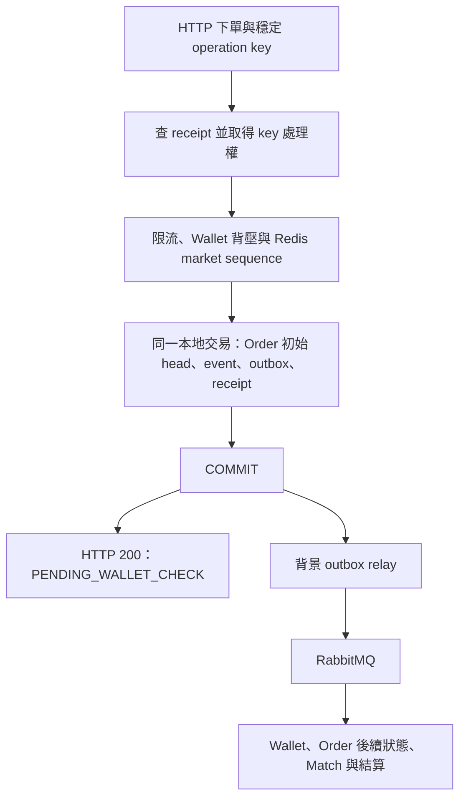

# ADR-007：CDA HTTP 下單受理模式

> 日期：2026-11-05
>
> 狀態：Accepted，保留現行直接受理模式；已完成增量診斷，正式容量驗證尚未完成
>
> 範圍：Order CDA BUY／SELL HTTP 入口；本次為設計評估，未變更執行程式或 API

## 問題

Order 已對 Wallet 驗資結果等內部事件採用 durable inbox，因此 HTTP 下單是否也應一律
先存入 command inbox，再由 worker 建立訂單？本次由 Architect 與 Performance 分別
唯讀評估，主代理合併交易邊界、故障情境與驗收要求。

## 決策

目前保留 **HTTP 直接完成 Order 初始事實與 outbox 的本地提交，再回傳受理結果**。
HTTP command inbox 暫不納入本輪變更。決策依據是既有受理語意與目前成本證據，
不是已證明現行 keyed 路徑達成某個容量或延遲 SLO。

兩個角色均建議保留現況，並將「keyed transaction 持有 command connection 等待外部依賴」
列為優先量測的風險。後續若需要調整 admission 與交易順序，必須另外定義競爭與重送契約；
不能直接搬動呼叫而破壞已完成重送繞過 admission、內容衝突與並行保護。

此圖描述新 keyed submission 的成功路徑；receipt 已存在時直接查回原受理結果，
不再執行 admission 或 append。未提供 key 的既有路徑不因此取得 HTTP 冪等保證。

HTTP 回應代表 `OrderSubmissionRequestedV1` 與 `PENDING_ASSET_CHECK` command state
等初始事實已提交；不代表驗資成功、可撮合或成交。既有 CQRS read projection 仍可能落後，
不能由此推論所有讀模型已立即可見。DB commit 後 HTTP 回應與背景 relay 各自推進，
不保證兩者誰先完成。

## 為什麼既有 inbox 不直接推出 HTTP 也需要 inbox

共同原則是「回應交付成功前，owner 已可靠保存處理責任」，不要求所有入口都多建一張表。

| 邊界 | 回應前已保存的事實 | 回應的意義 |
| --- | --- | --- |
| Wallet 結果 → Order inbox | 結果 payload、identity、待處理／重試狀態 | Rabbit ACK 後，Order 接管處理責任 |
| 目前 HTTP → Order | 初始 domain event、stream head、outbox；有 key 時另有 receipt | Order 已受理，後續驗資與交易非同步推進 |
| HTTP command inbox 替代方案 | command payload、key、待處理狀態 | 僅命令已收件，Order 初始事實可能尚未建立 |

既有結果 inbox 解決的是 durable retry／backoff、lease recovery、prerequisite 與矛盾結果
處置；目前 HTTP 入口已直接完成初始 command 的本地提交。再加 inbox 會引入新的處理階段，
其收益需要來自產品需求或量測，不能只以模式一致性判定。

兩種方案都需要 PostgreSQL 成功提交後才能承諾已收件；command inbox 不能消除
同一個 Order database 在 intake commit 前不可用的邊界。

## 程式與既有證據

- [初始 append](../../eap-order/src/main/java/com/eap/eap_order/eventstore/OrderEventAppender.java#L535)
  用一個 CTE 寫入 stream head、event 與 outbox。
- [HTTP 冪等協調器](../../eap-order/src/main/java/com/eap/eap_order/application/OrderSubmissionIdempotencyService.java#L65)
  以同一 command transaction 保存 submission 與 receipt，外層 commit 後才返回。
- [HTTP response](../../eap-order/src/main/java/com/eap/eap_order/application/OrderHttpSubmissionService.java#L55)
  為 `PENDING_WALLET_CHECK`；[outbox relay](../../eap-order/src/main/java/com/eap/eap_order/eventstore/OrderEventOutboxRelay.java#L91)
  由背景排程執行。
- [既有 Order inbox 文件](../order-asset-reservation-result-reliability.zh-TW.md)說明
  inbox commit → ACK → lease worker → domain event 與 APPLIED 同交易。
- [PLAT-201 證據](../features/http-command-idempotency.zh-TW.md)為 157 項一般測試與
  12 項 PostgreSQL 專屬測試；Redis sequence、rate limit 與 Rabbit backpressure 使用替身，
  不能據此宣稱真實依賴故障或 keyed capacity 已驗證。

## 效能成本與目前未知項

以下是新 orderId 成功 fast path 的程式碼靜態計數，不含 transaction control、
索引／WAL、pool 初始化或 Redis／Rabbit 操作，也不能直接換算 TPS。

| 路徑 | SQL 執行數 | 新增資料 |
| --- | --- | --- |
| 無 key 的初始 append | 1 個 CTE | head、event、outbox 共 3 筆 |
| 全新 key 的初始 append | 6 次（相較上列多 5 次） | 上列加 receipt，共 4 筆 |
| 已提交 key 的 replay | 4 次 | 不建立新下單事實 |
| 同 key 尚在處理的 busy | 3 次 | 不建立新下單事實 |

目前最大的入口風險假說是 connection hold time：外層 transaction 取得 command
connection 後，才做 rate limit（目前預設 local，可配置 Redis）、Wallet backpressure、
Redis sequence 與 append。
依賴變慢可能使不同 key 一起占用 pool。10 秒 transaction timeout 不是所有 monitor／RPC
等待的硬性上限。

[WalletQueueBackpressureGuard](../../eap-order/src/main/java/com/eap/eap_order/configuration/backpressure/WalletQueueBackpressureGuard.java#L82)
在 synchronized cache refresh 內執行 Rabbit queue probe，且 snapshot timestamp 取於 probe
之前；probe 比 TTL 慢時，完成的 snapshot 可能已過期。這是待驗證的集中等待風險，
尚非已量測的正常負載瓶頸。

新增 command inbox 仍會增加 durable command、claim、完成／重試狀態與監控工作。
它可能縮短 HTTP 等待、緩衝突發流量或便利批次，但不保證提升完成吞吐；若 downstream
已飽和，較快 intake 會增加 backlog 與等待時間。

[歷史全鏈摘要](../current-version-guide.zh-TW.md#目前版本的驗證摘要)的約 200 orders/s、
100.02 trades/s 是 2026-09-04、schema v3、單 seed、同機 dirty worktree、
`synchronous_commit=off` 的診斷結果，不是目前 keyed capacity、ceiling 或 production SLA。
初次模式評估未執行負載測試。後續同日已完成
[HTTP 冪等性增量成本量測](../benchmarks/2026-11-05-http-idempotency-comparison.md)：
三輪各模式在 200 unique orders/s 都完成全鏈 gate，新 key 的 p95 與 connection hold
有增加，但沒有持續 pool 等待或完成吞吐失敗；獨立重啟 replay 也通過。
這是同版、同機、dirty-source 診斷，不取代正式容量驗證或修改歷史容量數字。

## 下一個量測決策點

1. 固定 revision／working-tree fingerprint、依賴版本與 durability mode，以真實 Redis／Rabbit
   比較無 key、全新 key，以及固定比例 replay；重試 replay 不計成新接受訂單。
2. 先做 correctness／driver 校準，再做同設定的重複長窗比較。歷史 200 orders/s 可作比較點，
   不把它或專案早期的 2000 TPS 目標自動視為目前已承諾 SLO。
3. 分開報 submitted、HTTP durable accepted、matched、settled 與完整 schema-v4
   business-complete；捕捉 HTTP p95／p99、外層實體 commit、pool active／pending／acquire
   wait／hold time、admission／probe／sequence，以及各 owner debt count／oldest age／drain。
4. 若入口等待主導且下游有餘裕，先評估局部縮短 connection 持有與集中等待的方案；
   若 debt 主要累積於 reservation-result／projection，優先處理 EAP-PERF-203。
   目前未提供數值化 latency／availability SLO，因此本輪不判定容量達標或退化。

## 何時重新評估 HTTP command inbox

任一明確需求可觸發另行設計：

- 產品需要 Order DB 可用時，在 Redis／Rabbit 或 admission 暫停期間仍保存待處理命令，
  並接受稍後拒絕或失敗的回應語意。
- 需要跨入口排程、批次或明確的公平性規則。
- 重複量測證明入口無法滿足約定延遲／可用性目標，且較小範圍方案不足；原型 A/B
  顯示收益並非僅把 HTTP 等待移到 inbox。

## 若另開 inbox 實作，必須先定義的契約與驗收

- 交易 A：key／完整 command／受理 response 原子保存，或由同一 row 承擔；commit 後回
  `202 COMMAND_RECEIVED` 等明確收件語意，提供演進中的處理結果查詢。
- 交易 B：worker 將 Order event／head／outbox 與 command `APPLIED` 原子提交；具備
  lease fencing、crash recovery、bounded retry、terminal failure 與 owner recovery。
- 回應遺失後重送、同 key 併發／內容衝突、worker claim 後 crash、業務 commit 前後 crash
  都不能遺失已承諾收件的命令或重複建立 Order。
- 已收件但尚未建立初始 Order state 時的取消行為，不能默認沿用現行取消流程。
- 明訂 market sequence 配置、partition 與處理順序；現行 Redis sequence 的配置順序
  本來就不等於 HTTP 到達或 DB commit 順序，不能宣稱遷移會自動維持 FIFO／公平性。
- 受理回應 replay 保持原收件結果；當前處理狀態另查，不能混用。
- 設定可觀測的 backlog／oldest age 上限與過載拒收策略，將新增 work 納入 schema-v4
  `DurableDebtSnapshot` 的固定 allowlist、terminal／retry 分類與 final-zero gate。
- 用 command-to-business-complete 延遲、完成速率、故障後 drain、DB 總寫入及儲存增量驗收；
  較高 HTTP accepted TPS 本身不足以核准切換。

此決策不合併 operation key 與 orderId。兩者分別表達操作與訂單身份；建立一對一時
理論上可共用值，現行保留分開是生命週期與 API 語意選擇，不是宣稱兩個不同 UUID
是冪等性的必要條件。
